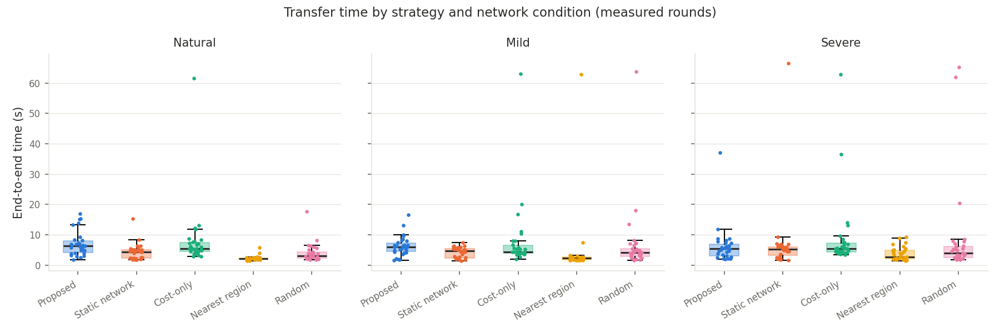
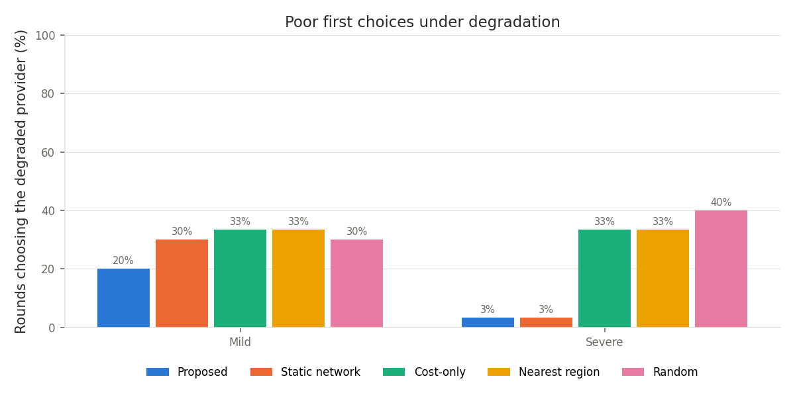

# Risk-Aware Adaptive Multi-Cloud Selection in Dynamic Networks

Computer Networks, Article Review project (2026).

When a file has to be uploaded to one of several cloud storage providers, can the
provider be chosen better by looking at the **current network condition**, the
**cost** and the **recent reliability** of each provider, instead of always choosing by
cost or by location?

This repository implements a risk-aware, adaptive selection method and evaluates it
against four baselines in a **simulated multi-cloud environment**. All results below
are simulation results: the providers, the network and the failures are simulated
from assumed profiles (see [Simulation model](#simulation-model)). They are not
measurements of real cloud services.

---

## Contents

1. [Quick start](#quick-start)
2. [Dashboard](#dashboard)
3. [The method](#the-method)
4. [Architecture](#architecture)
5. [Simulation model](#simulation-model)
6. [Experiment design](#experiment-design)
7. [Design decisions](#design-decisions)
8. [Results](#results)
9. [Limitations](#limitations)
10. [Repository layout](#repository-layout)

---

## Quick start

Any OS with Python 3.10+ (no cloud accounts or Linux tools needed).

```bash
pip install -r requirements.txt
pytest                                                        # 115 tests
python scripts/run_simulation.py --rounds-per-condition 30 --name final_30rounds --overwrite
```

A full run takes a few seconds (time is simulated). It writes
`results/<name>/` with the database, the schedule, and `analysis/` (`summary.txt`, CSV
tables and figures).

Options: `--seed N` (default 2026), `--rounds-per-condition N` (multiple of 3),
`--set key.path=value` to override one config value for a run (for example
`--set probe.max_age_s=0`), `--verbose` to print every transfer.

---

## Dashboard

An interactive Streamlit app for presenting the work:

```bash
streamlit run streamlit_app.py          # opens http://localhost:8501
```

| Tab | What it shows |
|---|---|
| **Results** | The committed 30-round run: headline numbers, transfer times per condition, the paired comparison (with significance), poor first choices, failures, which provider each strategy chose, and the effect of the probing change. |
| **Walkthrough** | Replays one decision at a time: the probes measured (or reused), why the weight profile was normal or severe, how each provider's score is built from network, cost and risk, the upload attempts and failover, what the other strategies did in the same round, and how the risk estimate evolved over the block. A highlight list jumps to interesting moments, for example a switch to the severe profile or a failover. |
| **What-if** | Change the weights, the degradation trigger, the probing, the risk window or the network conditions, and rerun the whole experiment with the real simulation code (about 3 s for 30 rounds). Shows the result next to the reported run. With the default settings it reproduces the reported run exactly. What-if runs are exploratory and are not the reported results. |

The walkthrough recomputes every score from the stored probes with the same functions
the strategy used, and the tests check that this matches the stored score for all
216 network-aware decisions.

### Deploy on Streamlit Community Cloud (free)

1. Push the repository to GitHub (already done for `a-niveditha/multi-cloud-selection`).
2. Sign in at [share.streamlit.io](https://share.streamlit.io) with GitHub. A private
   repository needs Streamlit to be given access to it.
3. **Create app**, then choose repository `a-niveditha/multi-cloud-selection`, branch
   `main` and main file `streamlit_app.py`. Under **Advanced settings**, pick Python 3.12.
4. **Deploy**. Streamlit installs `requirements.txt` and gives the app a public
   `*.streamlit.app` link. Every push to `main` redeploys it.

The app needs nothing else: the results it shows are committed in `results/`, and
What-if runs are written to a temporary folder.

---

## The method

Before an upload, the method gives every provider *i* a score:

```
Score_i = w_N * N_i  +  w_C * C_i  -  w_R * rho_i
```

| Term | Meaning | Computed from |
|---|---|---|
| `N_i` in [0, 1] | network performance (higher = better) | live probes of RTT, throughput and packet loss, min-max normalised across providers |
| `C_i` in [0, 1] | cost (higher = cheaper) | storage + egress price table, min-max normalised |
| `rho_i` in [0, 1] | observed risk (unreliability) | the last 10 attempts on that provider: timeout rate, failure rate, transfer-time variability, loss and RTT fluctuation |
| `w_N, w_C, w_R` | weights that **adapt** to the situation | `normal` profile (0.40 / 0.40 / 0.20) or `severe` profile (0.45 / 0.10 / 0.45) |

The method switches to the `severe` profile when any provider's live RTT is at least
50 % above its natural baseline, or its live loss is at least 2 %. Under degradation,
cost then matters less and risk matters more.

The provider with the highest score is tried first. If the upload times out (60 s),
fails, or fails checksum verification, the method **fails over** to the next-ranked
provider (at most 3 attempts). Every attempt updates the risk history.

**Baselines:**

| Strategy | Chooses by |
|---|---|
| `static_network` | live network score only (`w_N = 1`), no cost, no risk, no adaptation |
| `cost_only` | the cheapest provider, always |
| `nearest` | the provider with the lowest natural RTT, fixed once at the start |
| `random` | uniformly at random (seeded, reproducible) |

All strategies use the same failover rule, so the comparison is about the first choice.

---

## Architecture

```
 run_simulation.py / dashboard What-if  ->  rmc.simulation.simulate()
   |
   |-- MockProvider x3  (simulated providers: RTT, throughput, loss, jitter,
   |                     failures, timeouts, congestion episodes)
   |-- calibrate()      natural baseline per provider  -> setup (baseline, nearest order)
   |-- generate_schedule(seed)  9 blocks, rounds, randomised strategy order
   |
   '-- for each block:  BlockRunner
         |-- MockNetem.apply(degraded provider, mild|severe)        (clear at the end)
         '-- for each round, for each strategy (random order):
               |
               |  1. probe      MockProber -> ProbeResult per provider   (network-aware only;
               |                                                        reused while < 60 s old)
               |  2. select     Strategy.select()
               |                   normalise.py  N_i, C_i
               |                   risk.py       rho_i  <- HistoryStore (last K attempts)
               |                   weights.py    w_N, w_C, w_R (two_profile rule)
               |                   -> Decision (ranking of providers)
               |  3. transfer   transfer_with_failover()  -> provider.upload() + verify,
               |                   next provider on timeout / failure
               |  4. record     Database (SQLite): round runs, transfers, attempts, probes
               |  5. learn      attempts + probes -> HistoryStore (proposed strategy's own)
               v
         backup database
   |
   '-- analyse.run()   stats.py (paired tests), plots.py  -> results/<name>/analysis/
```

| Module | Responsibility |
|---|---|
| `rmc/providers/base.py` | provider interface; `upload()` times an attempt, classifies timeout/failure, verifies the checksum |
| `rmc/providers/mock.py` | the simulated provider (performance and failure model, see below) |
| `rmc/netem/netem.py` | `MockNetem`: applies/clears a network condition on one simulated provider path |
| `rmc/probing/probes.py` | probes (RTT, loss, throughput), natural-baseline calibration |
| `rmc/selection/normalise.py` | network score `N_i` and cost score `C_i` |
| `rmc/selection/risk.py` | risk history window and `rho_i` |
| `rmc/selection/weights.py` | pluggable weight-adaptation rules (`two_profile`) |
| `rmc/selection/strategies.py` | the proposed strategy and the four baselines |
| `rmc/transfer.py` | upload with failover; timing definitions |
| `rmc/runner/schedule.py` | seeded schedule: blocks, warm-up rounds, strategy order |
| `rmc/runner/runner.py` | runs a block: conditions, probing (with reuse), selection, transfer, history, resume after a crash |
| `rmc/db.py` | SQLite schema; every row is stamped with code version, config hash, block and time |
| `rmc/analysis/` | loading, paired statistics, figures |
| `rmc/clock.py` | simulated clock, so simulated transfers take "time" without waiting |

---

## Simulation model

### Providers

The three simulated providers stand for a client in India uploading to a near, a
medium-distance and a far region. **The values are assumptions** (rough orders of
magnitude), set in `config.yaml` under `simulation:`.

| Provider | Stands for | RTT | Throughput | Loss | Jitter (CV) | Base failure / timeout | Price (storage + egress, $/GB) |
|---|---|---|---|---|---|---|---|
| `aws_s3` | Mumbai (near) | 35 ms | 40 Mbit/s | 0.1 % | 0.20 | 1 % / 0.5 % | 0.025 + 0.11 |
| `gcs` | Belgium (medium) | 140 ms | 30 Mbit/s | 0.2 % | 0.25 | 1 % / 0.5 % | 0.020 + 0.12 |
| `b2` | US West (far, cheapest) | 240 ms | 20 Mbit/s | 0.3 % | 0.30 | 2 % / 1 % | 0.006 + 0.01 |

### Behaviour

- **Transfer time** = (3 x RTT for connection set-up + size / effective throughput) x
  log-normal jitter. Effective throughput drops by 10 % per 1 % of packet loss (capped
  at -90 %). This is a deliberately simple model, not a TCP model.
- **Loss-driven failures:** each 1 % of packet loss adds 2 % to both the failure and
  the timeout probability of an upload.
- **Congestion episodes:** each provider randomly enters a congested period (about 3
  per hour, mean length 90 s). During it, throughput is divided by 3 and the failure
  probability rises by 15 %. Probes see the slowdown too.
- **Failures and timeouts:** a failed upload breaks off part-way. A timed-out upload
  costs the full 60 s timeout. Both trigger failover.
- **Probes** cost what a real probe would: 3 TCP-connect samples (one RTT each) plus a
  128 KiB upload. Loss is estimated as lost samples / samples, so it is coarse.

### Network conditions

In each block one provider's simulated path is degraded (relative to its own natural RTT):

| Condition | Extra RTT | Extra loss |
|---|---|---|
| natural | none | none |
| mild | +25 % | +1 % |
| severe | +100 % | +5 % |

---

## Experiment design

- **Payload:** the same 10 MiB file (seeded, reproducible) for every transfer.
- **Paired rounds:** in every round, all five strategies upload the file once, in a
  freshly randomised order, with a 5 s (simulated) cooldown between transfers. This
  makes rounds comparable pair-by-pair.
- **Blocks:** 9 blocks = 3 conditions x 3 degraded providers (natural blocks degrade
  nothing). Every provider is degraded equally often, and block order is shuffled.
- **Rounds:** 30 measured rounds per condition (10 per block), plus 2 warm-up rounds
  per block. Warm-up rounds give the risk history something to start from and are
  analysed separately.
- **Totals:** 540 transfers (450 measured, 90 warm-up).
- **Metrics:** end-to-end time (probing + all attempts until success), probe overhead,
  failures, timeouts, failovers, failure-to-retry time, checksum verification, the
  provider chosen first, and whether it was the degraded one.
- **Statistics:** for each condition and baseline, the paired difference
  (baseline - proposed). Primary test: Wilcoxon signed-rank (paired t-test also
  reported). Holm correction over the 12 primary tests, alpha = 0.05. Failed transfers
  keep their end-to-end time (it contains the timeouts).
- **Reproducibility:** seed 2026 drives the providers, the schedule and the random
  baseline. The same command gives identical numbers. The code version and config
  hash are stored in every database row.

---

## Design decisions

| Area | Decision | Why |
|---|---|---|
| Environment | **Simulation** instead of real cloud buckets and Linux `tc`/netem | No dependency on cloud accounts, credentials, costs or a Linux VM; repeatable; any number of trials. The price is that results depend on the assumed provider profiles. |
| Providers | 3 providers: near / medium / far, with the far one cheapest | Creates a real trade-off between speed and cost, which is what an adaptive method should handle. |
| Score | `w_N*N + w_C*C - w_R*rho` with all terms in [0, 1] | Simple, explainable, and each term can be inspected on its own. |
| Network score | RTT, throughput, loss weighted 0.34 / 0.33 / 0.33, min-max across providers | No prior reason to prefer one component; min-max needs no fixed reference ranges. |
| Cost score | storage (1 month) + egress (1 download), min-max | Uploads are free on all three providers, so storage and egress are what costs money. |
| Risk | 10 most recent attempts per provider; timeout 0.30, failure 0.30, transfer-time CV 0.20, loss std 0.10, RTT CV 0.10 | Timeouts and failures cost the most time, so they weigh the most; variability is a weaker warning sign. |
| Risk history | only the proposed strategy's own attempts (`own`), reset per block | The method should not learn for free from the baselines' choices; each block starts from the same state. |
| Weight adaptation | two profiles: normal 0.40 / 0.40 / 0.20, severe 0.45 / 0.10 / 0.45 | Under normal conditions, cost is a legitimate goal; under degradation, speed and reliability matter more than saving money. |
| Degradation trigger | severe profile if any provider's RTT is >= 1.5 x baseline or loss is >= 2 % | Thresholds sit between "mild" (+25 % RTT, 1 % loss) and "severe" (+100 %, 5 %), so mild degradation should mostly keep the normal profile. (With 3 probe samples, one lost sample reads as 33 % loss and still triggers it.) |
| Failover | 60 s timeout, up to 3 attempts in score order; a checksum mismatch counts as a failure | Every transfer eventually succeeds unless all providers fail; the cost of a bad choice shows up as time. |
| Nearest baseline | lowest median RTT in the natural baseline, fixed for the run | The usual "pick the closest region" rule. |
| Probing (changed) | **3 RTT samples + 128 KiB throughput probe, reused for up to 60 s, re-probed after any failure** (previously 10 samples + 512 KiB before every decision) | In a first simulation, probing was about half of the method's end-to-end time. See [Effect of the probing change](#effect-of-the-probing-change). **This was decided after seeing simulation results**, and reuse applies equally to `static_network`. |
| Statistics | Wilcoxon signed-rank + Holm, failed transfers included | Few pairs per test and heavy-tailed times (timeouts), so a non-parametric paired test; Holm controls the 12-test family. |

---

## Results

Simulation, seed 2026, 30 measured rounds per condition (the code version and config
hash are recorded in the summary). Full output: [`results/final_30rounds/analysis/summary.txt`](results/final_30rounds/analysis/summary.txt).

### End-to-end transfer time (seconds; mean, with 90th percentile in brackets)

| Condition | **Proposed** | Static network | Cost-only | Nearest | Random |
|---|---|---|---|---|---|
| Natural | **7.09** (13.9) | 4.40 (6.3) | 8.09 (11.9) | 2.28 (2.8) | 4.05 (6.3) |
| Mild | **6.27** (9.7) | 4.21 (6.2) | 7.90 (11.7) | 4.41 (3.1) | 6.86 (8.8) |
| Severe | **6.30** (8.7) | 6.90 (7.0) | 8.90 (13.2) | 3.76 (7.0) | 8.73 (9.7) |



### Paired comparison (baseline - proposed, seconds; positive = proposed faster)

`*` = significant after Holm correction (p < 0.05).

| Baseline | Natural | Mild | Severe |
|---|---|---|---|
| Static network | -2.69 * | -2.05 * | +0.60 |
| Cost-only | +1.00 | +1.63 | +2.60 |
| Nearest | -4.81 * | -1.86 * | -2.53 * |
| Random | -3.04 * | +0.59 | +2.43 |

### Reliability and choices

| | Proposed | Static network | Cost-only | Nearest | Random |
|---|---|---|---|---|---|
| Chose the degraded provider first, mild | **20 %** | 30 % | 33 % | 33 % | 30 % |
| Chose the degraded provider first, severe | **3 %** | 3 % | 33 % | 33 % | 40 % |
| Transfers with a timeout (of 90) | **0** | 1 | 3 | 1 | 3 |
| Transfers needing failover (of 90) | 3 | 3 | 9 | 4 | 3 |
| Mean probe time per transfer | 1.78 s | 1.80 s | 0 | 0 | 0 |



Under severe degradation, the proposed method avoided the degraded provider
significantly more often than cost-only (p = 0.004), nearest (p = 0.012) and random
(p = 0.003) (paired sign test on rounds where only one of the two chose it;
exploratory, not corrected).

**Which provider the proposed method chose first:**

| Condition | aws_s3 (near) | gcs (medium) | b2 (far, cheapest) |
|---|---|---|---|
| Natural | 2 | 0 | 28 |
| Mild | 10 | 0 | 20 |
| Severe | 17 | 10 | 3 |

### Effect of the probing change

Same seed, 30 rounds per condition. Results in [`results/probe_variants/`](results/probe_variants/).

| Variant | Probe time | Proposed end-to-end | Probe share | Chose degraded provider | Failovers (of 90) |
|---|---|---|---|---|---|
| A. original (10 samples, 512 KiB, every decision) | 6.74 s | 13.63 s | 49 % | 28 % | 7 |
| B. light probes only | 2.97 s | 7.57 s | 39 % | 17 % | 2 |
| C. reuse only (60 s) | 4.54 s | 11.38 s | 40 % | 25 % | 11 |
| **D. light + reuse (adopted)** | **1.78 s** | **6.55 s** | **27 %** | **12 %** | 3 |

### What the results say

- **H1 (lower or more stable time than static network-aware selection under
  degradation): not supported.** Under severe degradation the proposed method is
  0.6 s faster on average and has a lower standard deviation (6.3 s vs 11.4 s), but
  the difference is not significant, and its 90th percentile is higher (8.7 s vs
  7.0 s). Under mild degradation it is significantly slower (-2.05 s).
- **H2 (fewer poor choices and less failure exposure): partly supported.** It is the
  only strategy with no timeouts at all. Under severe degradation it almost never
  chooses the degraded provider (3 %), far less than cost-only, nearest and random
  (33-40 %). But `static_network` does just as well on this point, and failovers are
  equally rare for both.
- **Why it is slower when the network is fine:** the method is doing what its
  weights tell it to. In natural and mild conditions the normal profile gives cost a
  weight of 0.40, so it picks the cheapest provider (B2, far away) in 28 of 30
  natural rounds. That is roughly 8x cheaper per GB than AWS, but slower. Once the
  degradation trigger fires (severe), it switches to the near and medium providers.
  Mild degradation is mostly below the trigger thresholds by design (one lost probe
  sample can still trip it), so in mild blocks it mostly keeps favouring cost.
- **The nearest-region baseline is fastest overall.** In this simulation the near
  provider is also the fastest, and it is degraded in only one third of the mild and
  severe blocks.
  A fixed "closest region" rule is hard to beat when the closest region is usually
  healthy.
- **Probing overhead matters.** Lighter probes plus reuse halved the method's
  end-to-end time (13.6 s to 6.6 s) and also reduced poor choices (28 % to 12 %).

---

## Limitations

- **Simulated, not measured.** Provider speeds, failure rates, congestion episodes
  and prices are assumptions. Different profiles could change the ranking of
  strategies.
- **Simple performance model.** Transfer time is a toy model of RTT, throughput and
  loss, not TCP congestion control.
- **One seed.** The main result uses seed 2026. Other seeds (`--seed N`) should be
  run to check that the conclusions hold.
- **Some settings were chosen after seeing simulation results:** the probing changes
  (reported above with all variants). The weights, risk components and thresholds were
  not tuned.
- **Coarse loss estimate.** With 3 samples, loss is measured in 33 % steps, so the
  probes only notice heavy loss. The risk history partly makes up for this.
- **Min-max normalisation** always gives the best provider 1 and the worst 0, even
  when they are nearly equal, which can exaggerate small differences.
- **Time-only metric.** The primary metric ignores cost, which is half of what the
  method optimises under normal conditions.

---

## Repository layout

```
.
├── README.md
├── requirements.txt
├── pyproject.toml
├── streamlit_app.py          # dashboard entry point
├── .streamlit/config.toml    # dashboard theme and server settings
├── dashboard/                # dashboard: data.py (no Streamlit), charts.py, one module per tab
├── config/config.yaml        # every setting and design decision
├── scripts/
│   ├── run_simulation.py     # run the whole experiment + analysis
│   ├── analyse.py            # re-analyse a results database
│   └── make_payload.py       # the 10 MiB payload (created automatically)
├── src/rmc/                  # see Architecture (simulation.py runs the whole experiment)
├── tests/                    # pytest (115 tests, including the dashboard run headless)
├── results/
│   ├── final_30rounds/       # main results: simulation.sqlite, schedule.json, setup.json,
│   │                         #   config.json (effective settings), analysis/
│   └── probe_variants/       # A_original, B_light, C_reuse (D = final_30rounds)
└── data/                     # generated payload and per-block backups (not committed)
```
